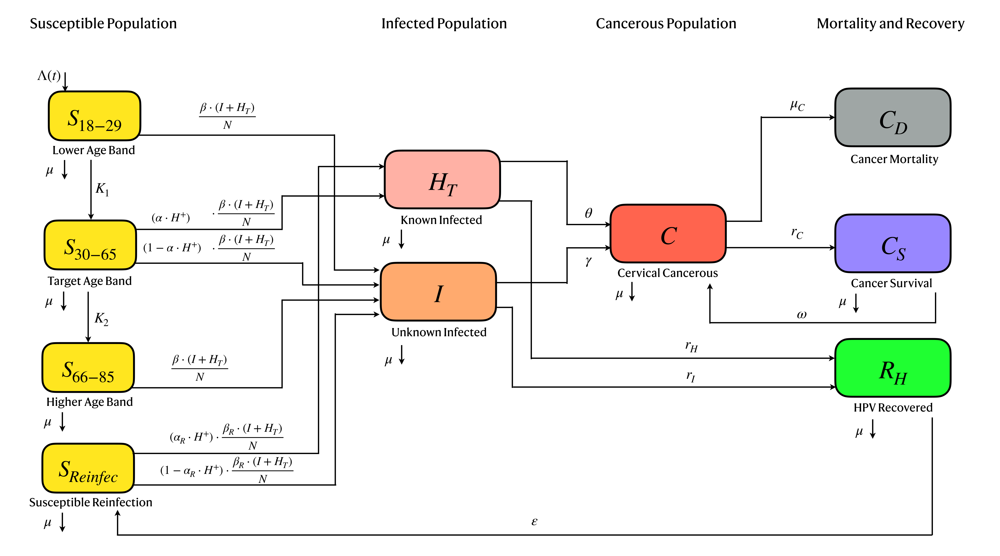
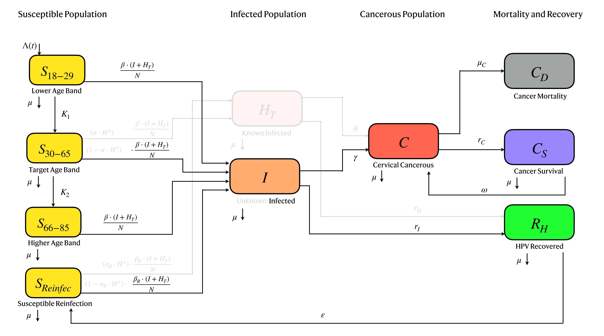
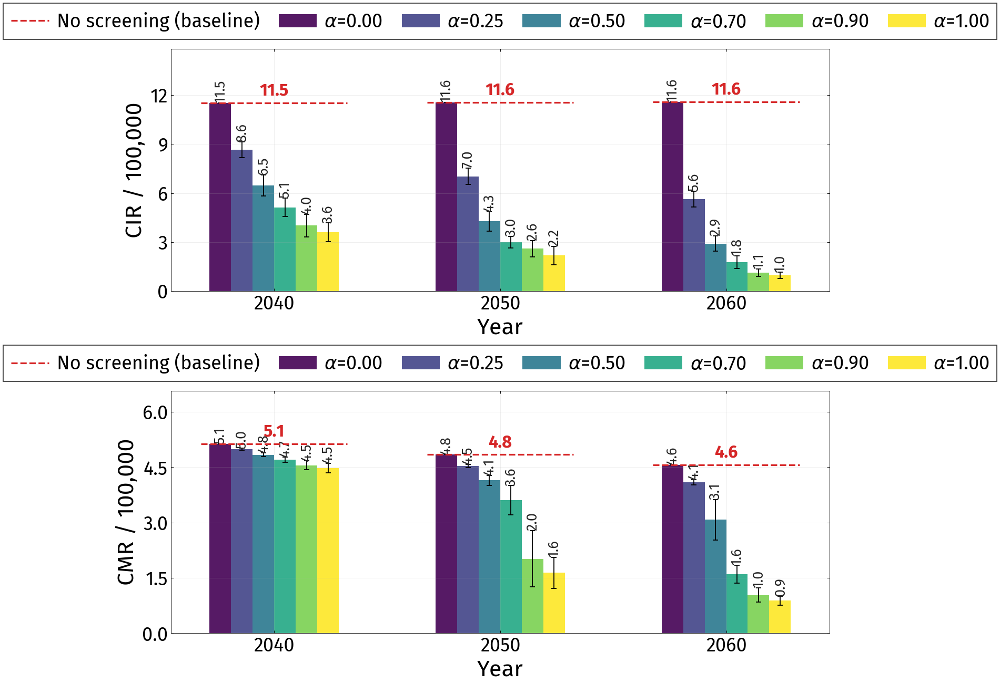
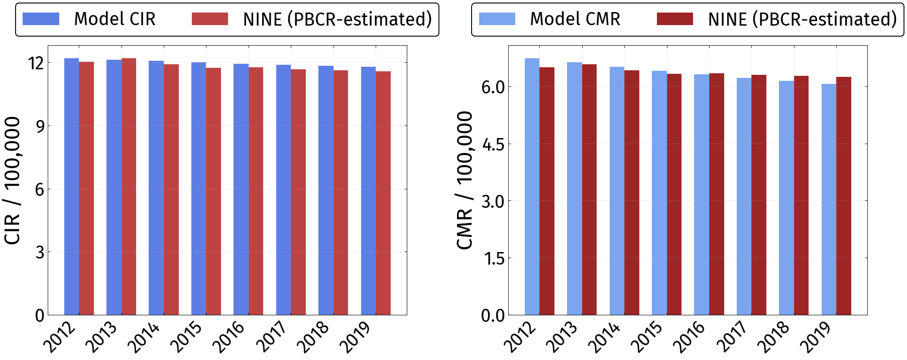

# HPV Testing Model — India

A compartmental model of **HPV infection, HPV testing and cervical cancer** among women in
India, with one fitted model for the country and one for each of its **36 states and
Union Territories**. The model projects crude cervical-cancer incidence and mortality from
2002 to 2070 and lets you explore screening programmes: coverage, test type, start year,
and any change to the model's parameters.

```bash
hpvcc run India --coverage 0 0.7 --plot india.png
```

| | |
|---|---|
| **Model** | 10-compartment ODE: susceptible women in three age bands, re-susceptible, undetected and screen-detected HPV infection, cervical cancer, recovered, survivors, deaths |
| **Units** | a national model + 36 state/UT models, each with its own fitted parameters and demography |
| **Screening** | coverage <i>α</i> ∈ [0, 1] of women aged 30–65, test sensitivity <i>H</i><sup>+</sup> (HPV-DNA 0.95, LBC 0.85, VIA 0.75, Pap 0.70), from 2026 by default |
| **Outputs** | crude incidence (CIR) and mortality (CMR) per 100,000 women, cases, deaths, every compartment, 95 % intervals |
| **Uncertainty** | 1000 stochastic simulations per screened scenario (<i>r</i><sub>H</sub>, <i>θ</i> redrawn every year); parameter-uncertainty band for the national model |
| **Figures** | drawn exactly as in the paper: same layouts, fonts, sizes and colours |

---

## Contents

- [The model](#the-model)
- [Installation](#installation)
- [Quick start](#quick-start)
- [Working with the model](#working-with-the-model)
- [Repository structure](#repository-structure)
- [Code architecture](#code-architecture)
- [Data and parameters](#data-and-parameters)
- [Reproducing the paper](#reproducing-the-paper)
- [Documentation](#documentation)
- [Citation and licence](#citation-and-licence)

---

## The model

### Model with HPV testing

<p align="center">
<picture>
  <source media="(prefers-color-scheme: dark)" srcset="assets/diagrams/dark/HPV_Testing_Model_for_Paper_for_Git.png">
  
</picture>
</p>

Women enter the youngest susceptible band <i>S</i><sub>18</sub> through the recruitment inflow
<i>p</i> <i>Λ</i>(<i>t</i>) and age through the three bands (rates <i>K</i><sub>1</sub>, <i>K</i><sub>2</sub>). They are infected at
rate <i>λ</i> = <i>β</i> (<i>I</i> + <i>H</i><sub>T</sub>)/<i>N</i>. From 2026 a screening programme reaches a fraction
<i>α</i> of women aged 30–65: infections the test finds (probability <i>H</i><sup>+</sup>) enter the
**known-infected** compartment <i>H</i><sub>T</sub>, where they are treated or cleared (<i>r</i><sub>H</sub> ≥ <i>r</i><sub>I</sub>) and progress
to cancer more slowly (<i>θ</i> ≤ <i>γ</i>). Infections in women not reached by screening, and in the
other age bands, are **undetected** (<i>I</i>): they clear at rate <i>r</i><sub>I</sub> or progress to cancer at
rate <i>γ</i>. An infection the test misses (a false negative) also stays undetected. Cancers either die (<i>μ</i><sub>C</sub> <i>C</i><sup><i>n</i><sub>PL</sub></sup>), survive
(<i>r</i><sub>C</sub>) or relapse from survival (<i>ω</i>). Recovered women lose immunity at rate
<i>ε</i> and can be re-infected (<i>β</i><sub>R</sub>). Everyone faces natural mortality <i>μ</i>.

### Baseline model (no testing)

<p align="center">
<picture>
  <source media="(prefers-color-scheme: dark)" srcset="assets/diagrams/dark/HPV_Testing_Baseline_Model_for_Paper_for_Git.png">
  
</picture>
</p>

Without screening (<i>α</i> = 0) the testing pathway is switched off (greyed out): every
infection is undetected and <i>H</i><sub>T</sub> stays empty. This is the model that was fitted to the
2012–2019 cancer registry rates.

### Compartments

| Symbol | Compartment | | Symbol | Compartment |
|:---:|---|---|:---:|---|
| <i>S</i><sub>18</sub> | susceptible, ages 18–29 | | <i>I</i> | undetected HPV infection |
| <i>S</i><sub>30</sub> | susceptible, ages 30–65 (screening target) | | <i>C</i> | cervical cancer |
| <i>S</i><sub>61</sub> | susceptible, ages 66–85 | | <i>R</i><sub>H</sub> | recovered from HPV |
| <i>S</i><sub>R</sub> | re-susceptible after loss of immunity | | <i>C</i><sub>S</sub> | cancer survivors |
| <i>H</i><sub>T</sub> | screen-detected (known) HPV infection | | <i>C</i><sub>D</sub> | cumulative cancer deaths |

Living population <i>N</i> = <i>S</i><sub>18</sub> + <i>S</i><sub>30</sub> + <i>S</i><sub>61</sub> + <i>S</i><sub>R</sub> + <i>H</i><sub>T</sub> + <i>I</i> + <i>C</i> + <i>R</i><sub>H</sub> + <i>C</i><sub>S</sub>, in
thousands of women.

### Parameters

| Symbol | Meaning | | Symbol | Meaning |
|:---:|---|---|:---:|---|
| <i>β</i> | HPV transmission rate | | <i>r</i><sub>C</sub> | cancer → survivor |
| <i>β</i><sub>R</sub> | transmission rate for re-susceptible women | | <i>μ</i><sub>C</sub>, <i>n</i><sub>PL</sub> | cancer mortality, deaths = <i>μ</i><sub>C</sub> <i>C</i><sup><i>n</i><sub>PL</sub></sup> |
| <i>γ</i> | progression of undetected infection to cancer | | <i>ω</i> | relapse of survivors to cancer |
| <i>θ</i> | progression of screen-detected infection to cancer (sampled) | | <i>ε</i> | loss of post-clearance immunity |
| <i>r</i><sub>I</sub> | clearance of undetected infection | | <i>μ</i> | natural mortality |
| <i>r</i><sub>H</sub> | clearance / treatment of screen-detected infection (sampled) | | <i>K</i><sub>1</sub>, <i>K</i><sub>2</sub> | ageing 18–29 → 30–65 → 66–85 |
| <i>p</i> | scaling of the recruitment inflow <i>Λ</i>(<i>t</i>) | | <i>α</i>, <i>H</i><sup>+</sup> | screening coverage, test sensitivity |

Rates are per year. Every parameter is fitted per unit, except <i>r</i><sub>H</sub> and
<i>θ</i>: these two are not fitted but sampled in every simulation, anew each year
(<i>r</i><sub>H</sub> ~ U(<i>r</i><sub>I</sub>, 1), <i>θ</i> ~ U(0, <i>γ</i>)). Equations, outputs and the ensembles are in [`docs/model.md`](docs/model.md); the
fitted value of every parameter for each unit in [`docs/parameters.md`](docs/parameters.md).

---

## Installation

Python ≥ 3.9.

```bash
git clone https://github.com/s-arvinth/hpv-testing-model-india.git
cd hpv-testing-model-india
pip install -e .                 # the model
pip install -e ".[maps,dev]"     # + state maps (geopandas) and tests (pytest)
```

or, with the exact versions used for the paper:

```bash
conda env create -f environment.yml && conda activate hpvcc
```

---

## Quick start

### Command line

```bash
hpvcc units                                    # the 37 modelled units
hpvcc params India                             # fitted parameters, with meanings
hpvcc fit India --plot fit.png                 # fitted model vs observed rates, 2012–2019
hpvcc run India                                # no-screening projection
hpvcc run India --coverage 0 0.5 0.7           # HPV-DNA testing at 50 % and 70 % coverage
hpvcc run India --coverage 0.75 --test pap via lbc hpv-dna --plot tests.png
hpvcc run India --coverage 0.7 --set beta=0.6 --start 2030 --out india.csv
hpvcc run Kerala --coverage 0 0.7              # any state/UT works the same way
```

```text
India: mean CIR and CMR per 100,000 women (deterministic, stochastic (1000 simulations))

 Coverage         Test  CIR_2030  CIR_2040  CIR_2050  CIR_2060  CIR_2070  CMR_2030  ...
      0.0 No screening     11.50     11.53     11.56     11.58     11.60      5.46  ...
      0.7 HPV DNA test      9.10      5.13      3.00      1.78      1.03      5.41  ...

First year with mean CIR < 4 per 100,000:
 Coverage         Test  First_year_CIR_below
      0.0 No screening                  <NA>
      0.7 HPV DNA test                  2045
```

### Python

```python
from hpvcc import project

proj = project("India", coverage=[0, 0.25, 0.5, 0.7, 0.9, 1.0], test="hpv-dna")
proj.summary()                    # CIR / CMR at 2030, 2040, …, 2070 for every scenario
proj.elimination_year()           # first year with mean CIR < 4 per 100,000
proj.table                        # every year 2003–2070, with 95 % intervals, cases and deaths
proj.plot("india.png")            # rates over time, every scenario
proj.plot_bars("india_bars.png")  # Figure 1
```

<p align="center">
  
</p>

**Figure 1.** Projected crude incidence (top) and mortality (bottom) of cervical cancer in
India (national model), per 100,000 women, in 2040, 2050 and 2060 by HPV-DNA testing
coverage (<i>H</i><sup>+</sup> = 0.95, from 2026): mean ± 95 % interval of 1000 stochastic
simulations, with the no-screening value of each year as the red dashed segment. With these
defaults the figure is the paper's Fig 3.

All figures — `plot()`, `plot_bars()`, `hpvcc.viz.plots.plot_fit()`, `plot_compartments()`
— use the paper's figure style ([`docs/usage.md`](docs/usage.md#plots)).

---

## Working with the model

| Task | How |
|---|---|
| Project a state or India under screening | `hpvcc run <unit> --coverage …` · `project(unit, coverage=…)` |
| Compare screening tests | `--test pap via lbc hpv-dna` or `--sensitivity 0.9` · `project(…, test=[…])` |
| Change when screening starts | `--start 2030` · `project(…, screening_start=2030)` |
| Change parameters | `--set beta=0.4 gamma=0.001` · `project(…, changes={"beta": 0.4})` |
| Use your own parameter file | `--params-file my.csv` · `project(…, params_file="my.csv")` |
| Fast single runs (no ensemble) | `--deterministic` · `project(…, deterministic=True)` |
| Check the fit to the observed rates | `hpvcc fit <unit> --plot fit.png` · `hpvcc.observed.model_fit(unit)` |
| Look at every compartment | `HPVCervicalCancerModel.for_unit(u).simulate()` · `hpvcc.viz.plots.plot_compartments` |
| Build custom ensembles | `hpvcc.simulation.StochasticEnsemble` with a `DrawScheme` |
| National parameter uncertainty | `hpvcc.uncertainty.ParameterSetEnsemble` |

Worked, runnable examples are in [`examples/`](examples/) and the full guide is
[`docs/usage.md`](docs/usage.md).

---

## Repository structure

```text
hpv-testing-model-india/
├── src/hpvcc/              the model package (see "Code architecture")
├── params/                 fitted parameters: 36 state/UT models, the national model,
│                           and the national model's parameter-uncertainty sets (CSV)
├── data/
│   ├── raw/                population projections, IHME prevalence, literature HPV prevalence
│   ├── processed/units/    model inputs per unit (population, recruitment, initial state)
│   └── registry/           observed CIR and CMR, 2012–2019 (what the models were fitted to)
├── examples/               runnable scripts: projections, screening tests, what-if parameters, fit
├── docs/                   model, parameters, usage, code structure
├── assets/                 model diagrams (light / dark / paper), Fira Sans fonts, state map
├── tests/                  unit tests and regression tests against the reference results
└── paper/                  reproduction of the paper's simulations, tables and figures
```

---

## Code architecture

```text
 params/*.csv ──► ModelParameters ─┐
                                   ├─► HPVCervicalCancerModel ──► Scenario(s) + DrawScheme ──► StochasticEnsemble
 data/processed ──► UnitInputs ────┘        (ODE system)                                            │
                                                                                                    ▼
                           project() ──► Projection: table of CIR / CMR / cases / deaths ──► summary · plots · CSV
```

| Module | Responsibility |
|---|---|
| [`model.py`](src/hpvcc/model.py) | the ODE right-hand sides (baseline and with testing) and `HPVCervicalCancerModel` |
| [`parameters.py`](src/hpvcc/parameters.py) | `ModelParameters` (frozen dataclass), loading and editing parameter sets |
| [`inputs.py`](src/hpvcc/inputs.py) | `UnitInputs`: population, rate denominator, recruitment <i>Λ</i>(<i>t</i>), initial conditions |
| [`simulation.py`](src/hpvcc/simulation.py) | `Scenario`, random-draw schemes for the screened pathway, `StochasticEnsemble` |
| [`projection.py`](src/hpvcc/projection.py) | `project()` — scenario(s) → tidy table, summaries, elimination year, plots |
| [`metrics.py`](src/hpvcc/metrics.py) | CIR (inflow method), CMR, ensemble interval convention |
| [`observed.py`](src/hpvcc/observed.py) | the observed 2012–2019 rates and the model-vs-observed comparison |
| [`uncertainty.py`](src/hpvcc/uncertainty.py) | parameter-uncertainty band from an ensemble of parameter sets |
| [`data/`](src/hpvcc/data/) | builds `data/processed` from the population and prevalence sources |
| [`viz/`](src/hpvcc/viz/) | the paper's figure style and figure types, unit colours, plots of your runs |
| [`paper/`](src/hpvcc/paper/) | the paper's experiments, tables and figures (`hpvcc paper …`) |
| [`cli.py`](src/hpvcc/cli.py) | the `hpvcc` command |

Design notes and how to extend the model (new compartments, scenarios, draw schemes) are
in [`docs/code-structure.md`](docs/code-structure.md).

---

## Data and parameters

Everything needed to run the model is in the repository: the fitted parameters of every
unit ([`params/`](params/)) and the model inputs built from population projections, IHME
GBD prevalence and literature HPV prevalence ([`data/`](data/)).

The models were fitted to the crude incidence and mortality rates of the population-based
cancer registry estimates of ICMR-NCDIR / NINE for 2012–2019; these rates are in
[`data/registry/`](data/registry/) and are used to show the fit (`hpvcc fit`, Figs 1, 2,
S5–S10). The fitting itself is not part of this repository — every projection runs from
the fitted parameters ([`params/`](params/README.md)).

<p align="center">
  
</p>

**Figure 2.** Fit of the national model: crude incidence (left) and mortality (right) of
the fitted no-screening model (blue) and the registry estimates (NINE, PBCR-based; red),
2012–2019, per 100,000 women (`hpvcc fit India --plot fit.png`; the paper's Fig 1). The
model is within 1.5 % (CIR) and 0.1 % (CMR) of the observed 2012–2019 means.

---

## Reproducing the paper

Every simulation of the paper is defined, with its seeds, in
[`paper/experiments.yaml`](paper/experiments.yaml), and `hpvcc paper all` regenerates all
the paper's results tables and figures (about 15 min on 80 cores), with 1000 stochastic
simulations per screened scenario and fixed seeds. Commands per figure and table, run
times, and the reference results the tests check against:
[`paper/README.md`](paper/README.md).

---

## Documentation

| | |
|---|---|
| [`docs/model.md`](docs/model.md) | compartments, equations, outputs, stochastic pathway, model notes |
| [`docs/parameters.md`](docs/parameters.md) | every parameter and its fitted value for each unit |
| [`docs/usage.md`](docs/usage.md) | command line and Python guide |
| [`docs/code-structure.md`](docs/code-structure.md) | package design and how to extend it |
| [`data/README.md`](data/README.md) | data sources and how model inputs are built |
| [`paper/README.md`](paper/README.md) | reproducing the paper |

---

## Citation and licence

Please cite the paper and this repository ([`CITATION.cff`](CITATION.cff)).
Licence: *to be added by the authors*. Fira Sans is © Mozilla / Carrois Apostrophe,
SIL Open Font License 1.1.
