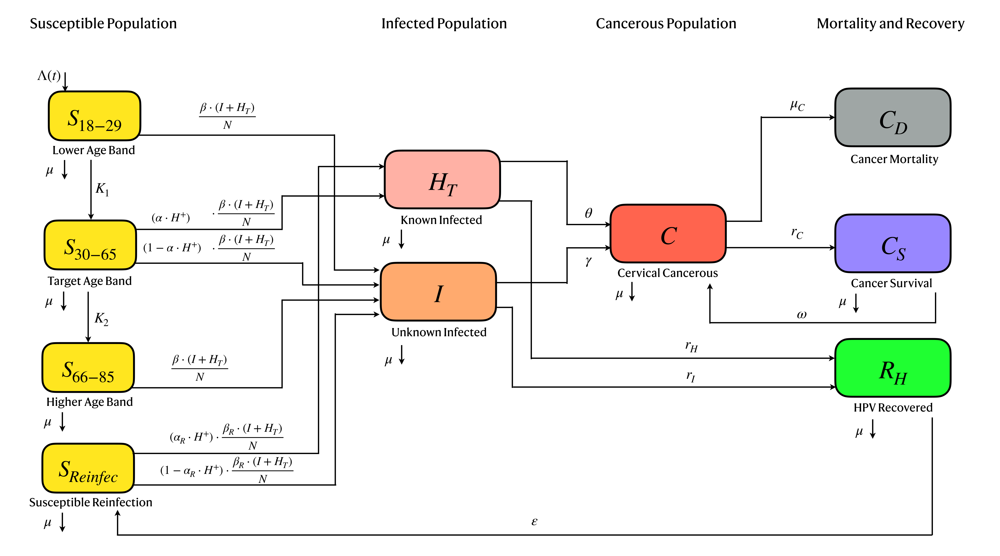
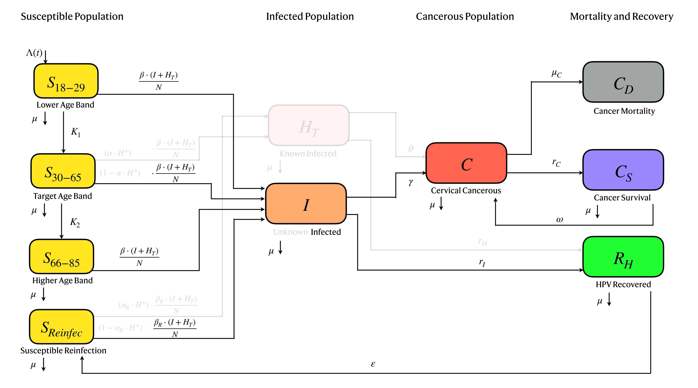

# The model

A deterministic 10-compartment ODE model of HPV infection and cervical cancer in women,
with HPV testing (screening) and a stochastic treatment of the screened pathway. There is
one model per unit — the national (India) model and 36 independently fitted state/UT
models — sharing the same structure and differing in parameters and demography.
Code: [`src/hpvcc/model.py`](../src/hpvcc/model.py).

<p align="center">
<picture>
  <source media="(prefers-color-scheme: dark)" srcset="../assets/diagrams/dark/HPV_Testing_Model_for_Paper_for_Git.png">
  
</picture>
</p>

## Compartments

Populations are in thousands of women.

| Symbol | Code | Meaning | Diagram label |
|:---:|---|---|---|
| <i>S</i><sub>18</sub> | `S18` | susceptible, ages 18–29 | lower age band |
| <i>S</i><sub>30</sub> | `S30` | susceptible, ages 30–65 — the screening target | target age band |
| <i>S</i><sub>61</sub> | `S61` | susceptible, ages 66–85 | higher age band |
| <i>S</i><sub>R</sub> | `S_R` | re-susceptible after loss of post-clearance immunity | susceptible reinfection |
| <i>H</i><sub>T</sub> | `H_T` | HPV infection detected by screening | known infected |
| <i>I</i> | `I` | undetected HPV infection | unknown infected |
| <i>C</i> | `C` | cervical cancer | cervical cancerous |
| <i>R</i><sub>H</sub> | `R_H` | recovered from HPV (immune) | HPV recovered |
| <i>C</i><sub>S</sub> | `C_S` | cancer survivors | cancer survival |
| <i>C</i><sub>D</sub> | `C_D` | cumulative cancer deaths (a counter) | cancer mortality |

Living population <i>N</i> = <i>S</i><sub>18</sub> + <i>S</i><sub>30</sub> + <i>S</i><sub>61</sub> + <i>S</i><sub>R</sub> + <i>H</i><sub>T</sub> + <i>I</i> + <i>C</i> + <i>R</i><sub>H</sub> + <i>C</i><sub>S</sub>.

## Equations

Force of infection <i>λ</i> = <i>β</i> (<i>I</i> + <i>H</i><sub>T</sub>)/<i>N</i> in the three age bands and
<i>λ</i><sub>R</sub> = <i>β</i><sub>R</sub> (<i>I</i> + <i>H</i><sub>T</sub>)/<i>N</i> for re-susceptible women. Screening coverage is
<i>a</i>(<i>t</i>) = 0 before the programme starts (2026 by default) and <i>α</i> afterwards; <i>H</i><sup>+</sup> is
the test sensitivity. Re-infections are screened in proportion to the 30–65 band's share
of new infections:

```math
f_{30} = \frac{(1-a)\,\lambda S_{30}}{(1-a)\,\lambda S_{30} + \lambda S_{18} + \lambda S_{61} + \lambda_R S_R},
\qquad a_R = a\, f_{30}
```

```math
\begin{aligned}
\frac{dS_{18}}{dt} &= p\,\Lambda(t) - (\lambda + K_1 + \mu)\,S_{18} \\
\frac{dS_{30}}{dt} &= K_1 S_{18} - (\lambda + K_2 + \mu)\,S_{30} \\
\frac{dS_{61}}{dt} &= K_2 S_{30} - (\lambda + \mu)\,S_{61} \\
\frac{dS_R}{dt} &= \varepsilon R_H - (\lambda_R + \mu)\,S_R \\
\frac{dH_T}{dt} &= a H^+ \lambda S_{30} + a_R H^+ \lambda_R S_R - (\theta + r_H + \mu)\,H_T \\
\frac{dI}{dt} &= (1-a H^+)\,\lambda S_{30} + \lambda S_{18} + \lambda S_{61} + (1-a_R H^+)\,\lambda_R S_R - (\gamma + r_I + \mu)\,I \\
\frac{dC}{dt} &= \theta H_T + \gamma I + \omega C_S - (r_C + \mu)\,C - \mu_C\, C^{n_{PL}} \\
\frac{dR_H}{dt} &= r_H H_T + r_I I - (\varepsilon + \mu)\,R_H \\
\frac{dC_S}{dt} &= r_C C - (\omega + \mu)\,C_S \\
\frac{dC_D}{dt} &= \mu_C\, C^{n_{PL}}
\end{aligned}
```

A screened woman's new infection is detected with probability <i>H</i><sup>+</sup> and
enters <i>H</i><sub>T</sub>. An infection the test misses (a false negative) is still an
infection: it joins the undetected pool <i>I</i>, together with the infections of women
who are not screened. A more sensitive test therefore always lowers incidence.

The symbols and their fitted values are listed in [`parameters.md`](parameters.md).
<i>r</i><sub>H</sub> and <i>θ</i> have no fitted value: they are sampled (see
[below](#stochastic-screened-pathway)).

### Baseline model

<p align="center">
<picture>
  <source media="(prefers-color-scheme: dark)" srcset="../assets/diagrams/dark/HPV_Testing_Baseline_Model_for_Paper_for_Git.png">
  
</picture>
</p>

With <i>a</i> = 0 the testing terms vanish, <i>H</i><sub>T</sub> stays empty and the system reduces to the
baseline model above (`rhs_no_screening` in the code). The parameters were fitted on
this model to cancer registry incidence and mortality rates for 2012–2019
([`data/registry/`](../data/registry/); `hpvcc fit UNIT` shows the fit).

### Integration

`scipy.integrate.odeint`, restarted every calendar year from 2002 to 2070. Restarting
yearly lets the stochastic ensembles redraw <i>r</i><sub>H</sub> and <i>θ</i> between
years. The right-hand sides have a fixed floating-point evaluation order, so the fitted
trajectories are reproduced exactly.

## Inputs

Each unit has a [`UnitInputs`](../src/hpvcc/inputs.py) object (stored in
`data/processed/units/<unit>.json`):

| Input | State/UT models | National model |
|---|---|---|
| women by age band | state population projections, 18–29 / 30–65 / 66+ | NDMC India projections, back-cast to 2002 |
| recruitment Λ(t) | 18–29 population ten years ahead (linear interpolation) | 18–29 series shifted ten years (step function) |
| rate denominator | women aged 18–85 (the three bands) | all-age women |
| initial infections I(2002) | literature HPV prevalence × women | 20.9 % of all-age women |
| initial cancers C(2002) | IHME GBD prevalent cases | 800 thousand |

Details: [`data/README.md`](../data/README.md).

## Outputs

* **Crude incidence rate (inflow method).** New cancers in year t are the change in the
  cancer stock plus everything that left it during the year:
  `cases(t) = max(C(t) − C(t−1) + (r_C + μ) C(t−1) + μ_C C(t−1)^{n_PL}, 0)`,
  `CIR = cases / N_denominator × 10⁵`. (ΔC alone would miss cancers that arose and left
  within the year.)
* **Crude mortality rate.** `CMR = max(C_D(t) − C_D(t−1), 0) / N_denominator × 10⁵`.
* **Elimination proxy.** Mean CIR < 4 per 100,000 women. The WHO threshold is defined on
  age-standardised incidence, which this model does not compute.

Because the denominators differ (18–85 for states, all ages for India), rates are
comparable between units but counts are not on the same basis.

## Stochastic screened pathway

Two rates of the screened pathway are not fitted but sampled, anew for every simulated
year of every simulation:

| Rate | Meaning | Distribution |
|:---:|---|---|
| <i>r</i><sub>H</sub> | clearance / treatment of screen-detected infection | U(<i>r</i><sub>I</sub>, 1) |
| <i>θ</i> | progression of screen-detected infection to cancer | U(0, <i>γ</i>) |

That is, a detected infection clears at least as fast as an undetected one and progresses
to cancer at most as fast. Every other rate is fixed at its fitted value. No parameter
file stores a value of <i>r</i><sub>H</sub> or <i>θ</i>. Since <i>H</i><sub>T</sub> is empty
without screening, the no-screening arm is deterministic.

The design is the same for every unit (the national model and the 36 state/UT models):

* **1000 simulations** per screened scenario;
* simulation *j* of a scenario draws from `numpy.random.default_rng([seed, key, j])`, with
  `seed = 0` and `key` = coverage / 0.05. A result at a given coverage therefore does not
  depend on which other scenarios are run with it, and scenarios at the same coverage
  (different tests) share their draws.

The 95 % interval of an annual rate is built by the *trajectory method*: take the 2.5th and
97.5th percentile trajectories of <i>C</i> and <i>C</i><sub>D</sub> across simulations,
convert each to a rate, and report mean ± |hi − lo| / 2.

These are the defaults of `project()` / `hpvcc run`
([`simulation.YearlyDraws`](../src/hpvcc/simulation.py)). `deterministic=True` instead runs
once at the midpoints of the sampling ranges, <i>r</i><sub>H</sub> = (<i>r</i><sub>I</sub> + 1)/2
and <i>θ</i> = <i>γ</i>/2.

## Parameter uncertainty (national model)

[`params/india_uncertainty_sets.csv`](../params/india_uncertainty_sets.csv) holds 500
alternative parameter sets of the national model: the accepted sets of a GLUE-style Monte
Carlo analysis (10,000 sets sampled uniformly within ±25 % of the fitted values of β, β_R,
γ, r_I, ε, μ_C, ω, r_C; the 5 % that best reproduced the calibration targets were kept,
best first). Simulating each set gives the uncertainty band of the no-screening projection
([`uncertainty.ParameterSetEnsemble`](../src/hpvcc/uncertainty.py)).

## Model notes

1. **Screening acts on new infections.** Detection happens when an infection is acquired
   (with probability <i>a</i>·<i>H</i><sup>+</sup> in the screened band); infections that
   are already in <i>I</i> are not found later. Coverage is therefore best read as the
   share of women aged 30–65 who are under regular testing.
2. **Re-infections** are screened with coverage <i>a</i><sub>R</sub> = <i>a</i>·<i>f</i><sub>30</sub>,
   where <i>f</i><sub>30</sub> is the 30–65 band's share of the infections that screening
   does not reach.
